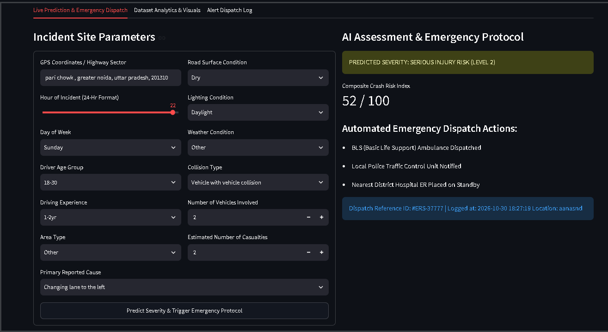
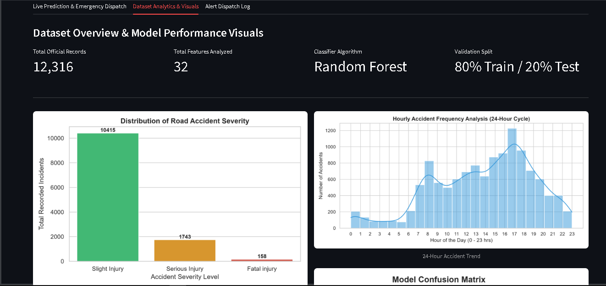
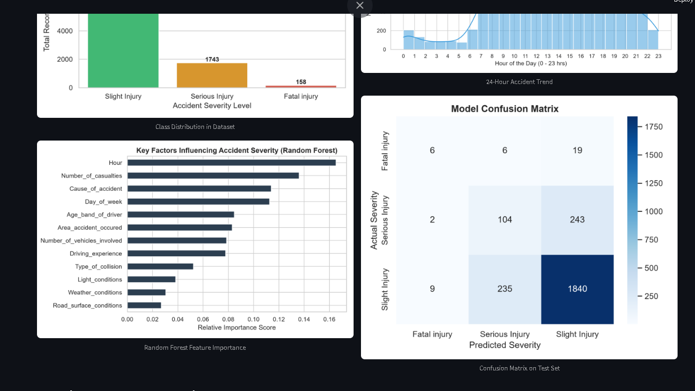
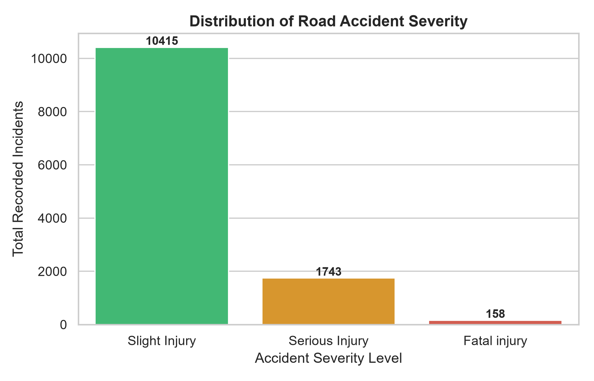
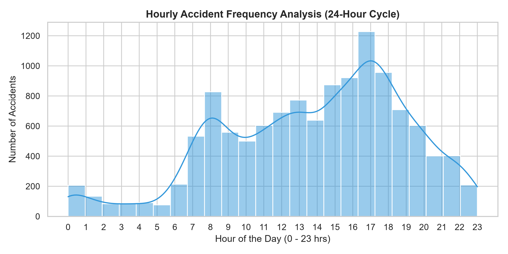
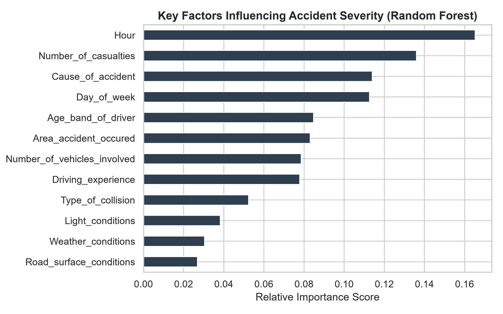
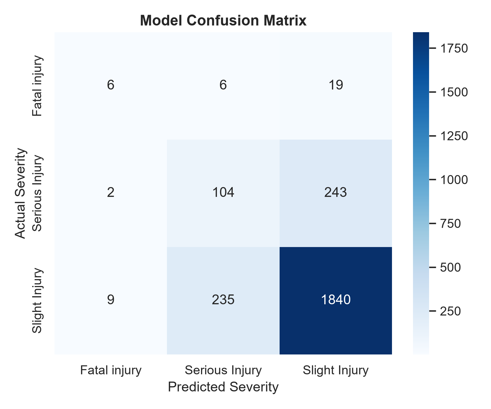
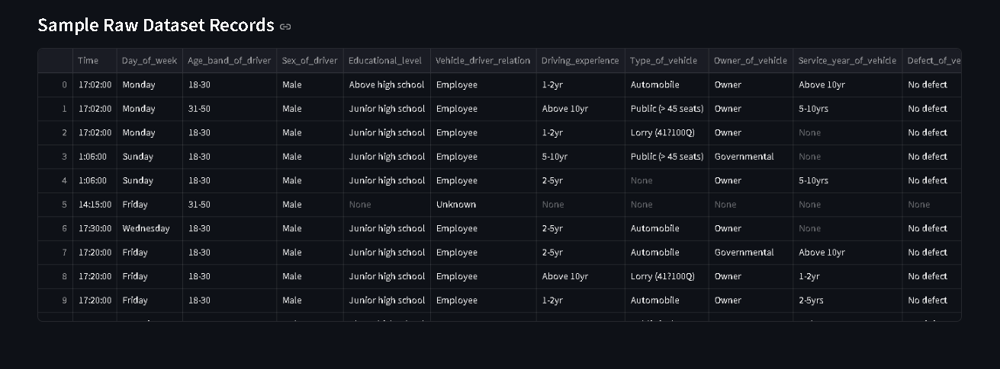
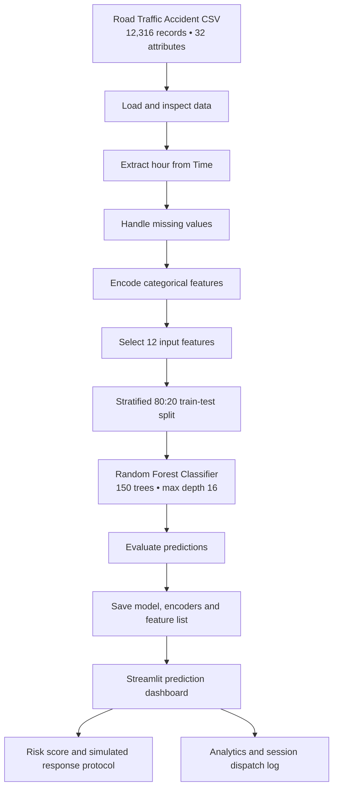

<div align="center">
  
  <br />
  <p>
    
    
    
    
    
  </p>
  <h3>Predict accident severity. Understand risk factors. Demonstrate an emergency response workflow.</h3>
  <p>
    A Python machine-learning project that classifies road accident severity from historical incident details and presents the prediction, crash-risk score, analytics and simulated emergency response actions in an interactive dashboard.
  </p>
</div>

---

## Contents

- [Project overview](#-project-overview)
- [Dashboard preview](#-dashboard-preview)
- [Key features](#-key-features)
- [Dataset](#-dataset)
- [Machine-learning workflow](#-machine-learning-workflow)
- [Model configuration and evaluation](#-model-configuration-and-evaluation)
- [Emergency escalation logic](#-emergency-escalation-logic)
- [Technology stack](#-technology-stack)
- [Project structure](#-project-structure)
- [Getting started](#-getting-started)
- [Limitations and responsible use](#-limitations-and-responsible-use)
- [Future improvements](#-future-improvements)
- [Dataset attribution and licensing](#-dataset-attribution-and-licensing)

## 🚦 Project overview

Road accident outcomes can vary with the time of the incident, road and weather conditions, lighting, collision type, driver experience and the number of vehicles and casualties involved. This project explores how historical accident records can be used to classify the severity of an incident.

A **Random Forest Classifier** is trained on the Road Traffic Accident Dataset of Addis Ababa. The saved model is integrated into a **Streamlit** dashboard where a user can enter incident details and obtain one of three model predictions:

| Predicted class | Meaning |
|---|---|
| `Slight Injury` | Lower injury-severity category in the source dataset |
| `Serious Injury` | Serious injury category in the source dataset |
| `Fatal injury` | Fatal injury category in the source dataset |

Alongside the model prediction, the dashboard calculates a rule-based crash-risk index and displays a corresponding emergency response protocol. Dispatch actions are **simulated in the application**; the prototype does not contact real emergency services.

## 🖥️ Dashboard preview

The main interface brings incident inputs and the model assessment together.

<div align="center">
  
  <sub>Live Prediction &amp; Emergency Dispatch tab — sample dashboard state.</sub>
</div>

### Analytics and dataset views

<div align="center">
  
  <br />
  <sub>Dataset Analytics &amp; Visuals tab.</sub>
  <br /><br />
  
  <br />
  <sub>Feature importance and confusion-matrix views.</sub>
</div>

### Generated analysis charts

<table>
  <tr>
    <td width="50%"><br /><sub><b>Accident severity distribution</b></sub></td>
    <td width="50%"><br /><sub><b>Hourly accident frequency</b></sub></td>
  </tr>
  <tr>
    <td width="50%"><br /><sub><b>Random Forest feature importance</b></sub></td>
    <td width="50%"><br /><sub><b>Confusion matrix</b></sub></td>
  </tr>
</table>

### Sample dataset records



## ✨ Key features

- **Multi-class accident severity prediction** using a trained Random Forest model.
- **12 model input features** covering time, driver, road, weather, collision and casualty information.
- **Data preprocessing** with mode/median imputation and categorical label encoding.
- **Exploratory data analysis** for severity distribution and hourly accident frequency.
- **Model interpretation visuals** including feature importance and a confusion matrix.
- **Rule-based emergency escalation** that combines the model output with a crash-risk score.
- **Dispatch reference generation** and an in-session alert log.
- **Interactive Streamlit interface** with three tabs for prediction, analytics and dispatch logs.

## 📊 Dataset

| Property | Details |
|---|---|
| Dataset | Road Traffic Accident Dataset of Addis Ababa City |
| Source | Addis Ababa sub-city police department manual accident records |
| Coverage period | 2017–2020 |
| Records | 12,316 |
| Attributes | 32 |
| Target column | `Accident_severity` |
| Dataset author | Tarikwa Tesfa Bedane |
| Source DOI | [10.17632/xytv86278f.1](https://doi.org/10.17632/xytv86278f.1) |

The dataset's target distribution is imbalanced:

| Severity class | Records | Share |
|---|---:|---:|
| Slight Injury | 10,415 | 84.56% |
| Serious Injury | 1,743 | 14.15% |
| Fatal injury | 158 | 1.28% |
| **Total** | **12,316** | **100%** |

### Features used by the model

The training script selects the following 12 features:

1. `Hour` — hour extracted from the recorded time.
2. `Day_of_week` — day on which the accident occurred.
3. `Age_band_of_driver` — driver age group.
4. `Driving_experience` — reported driving experience category.
5. `Area_accident_occured` — accident area category.
6. `Road_surface_conditions` — road surface condition.
7. `Light_conditions` — lighting condition at the time of the accident.
8. `Weather_conditions` — weather condition.
9. `Type_of_collision` — collision category.
10. `Number_of_vehicles_involved` — vehicles involved.
11. `Number_of_casualties` — casualties recorded.
12. `Cause_of_accident` — reported cause category.

The model target is `Accident_severity`. The location text field in the dashboard is displayed in the dispatch record; it is **not** one of the model's 12 prediction features.

## 🧠 Machine-learning workflow



### Preprocessing performed

- Extract the hour from the `Time` column.
- Fill missing categorical values using the column mode.
- Fill missing numerical values using the column median.
- Encode categorical inputs and the target using `LabelEncoder`.
- Separate the selected input features from the target column.
- Split the data into training and testing subsets using stratification.

## 🌲 Model configuration and evaluation

The supplied training script uses `RandomForestClassifier` with the following settings:

| Parameter | Configuration |
|---|---|
| Algorithm | Random Forest Classifier |
| Number of trees (`n_estimators`) | 150 |
| Maximum depth (`max_depth`) | 16 |
| Class weighting | `balanced` |
| Random state | 42 |
| Train/test split | 80% / 20% |
| Split strategy | Stratified |
| Selected input features | 12 |

The confusion-matrix screenshot supplied with the project shows the following test-set counts. Rows represent actual classes and columns represent predicted classes; the class order is Fatal, Serious, Slight.

| Actual \ Predicted | Fatal | Serious | Slight |
|---|---:|---:|---:|
| Fatal injury | 6 | 6 | 19 |
| Serious Injury | 2 | 104 | 243 |
| Slight Injury | 9 | 235 | 1,840 |

From this displayed matrix, the diagonal contains 1,950 correct predictions out of 2,464 test examples (approximately **79.14% accuracy**). The fatal-injury recall in this matrix is **19.35%** (6 of 31 fatal-injury examples). This is an important limitation: the overall accuracy is dominated by the majority `Slight Injury` class and should not be treated as equivalent performance across all severity levels.

> **Reproducibility note:** the accuracy above is calculated from the confusion-matrix image included with the supplied project screenshots. Re-running model training under a different package/runtime environment can produce different metrics; use the output from your own final training run when reporting a new evaluation.

## 🚑 Emergency escalation logic

After the classifier predicts a severity category, the dashboard calculates a separate rule-based risk score:

```text
Risk score = (number of casualties × 18)
           + (number of vehicles × 8)
           + lighting adjustment
           + weather/road adjustment
```

Additional score conditions in `app.py`:

- Darkness lighting condition: `+15`
- Wet road surface or rainy weather: `+12`
- Displayed score is capped at `99 / 100`.

The application then selects a response level:

| Level | Trigger condition | Demonstrated response actions |
|---|---|---|
| **Level 1 — Critical** | Fatal-injury prediction **or** risk score ≥ 75 | Advanced Life Support ambulance, trauma-hospital alert, highway patrol/fire rescue and SOS notification actions displayed |
| **Level 2 — Serious** | Serious-injury prediction **or** risk score ≥ 48, unless Level 1 applies | Basic Life Support ambulance, local police traffic-control notification and district-hospital standby actions displayed |
| **Level 3 — Minor** | All other cases | First-aid patrol, traffic/tow assistance and incident logging actions displayed |

The app generates a dispatch reference ID and records timestamp, location, predicted severity, vehicle count, casualty count, weather and lighting in the current Streamlit session.

> **Safety notice:** these are simulated software actions. The current implementation does not send SMS messages, call emergency numbers, locate nearby hospitals, or dispatch ambulances, police or fire services. The risk score is a project-defined heuristic, not a calibrated medical or emergency-response score.

## 🧰 Technology stack

| Technology | Role in the project |
|---|---|
| Python | Application and model-training language |
| Pandas | CSV loading, data selection and preprocessing |
| NumPy | Numerical operations |
| Scikit-learn | Label encoding, train/test split, Random Forest and evaluation |
| Matplotlib | Plot generation |
| Seaborn | Statistical charts and confusion matrix |
| Streamlit | Interactive web dashboard |
| Joblib | Saving and loading model artifacts |

## 📁 Project structure

```text
Road_Accident_Project/
│
├── app.py
├── train_model.py
├── RTA Dataset.csv
├── requirements.txt
├── README.md
│
├── accident_model.pkl
├── encoders.pkl
├── features.pkl
│
├── plots/
│   ├── severity_distribution.png
│   ├── hourly_accidents.png
│   ├── feature_importance.png
│   └── confusion_matrix.png
│
├── assets/
│   ├── road-safety-banner.svg
│   └── screenshots/
│       ├── live-prediction-dashboard.png
│       ├── analytics-overview.png
│       ├── model-analytics-detail.png
│       └── sample-dataset-records.png
│
└── Project Screenshots/
```

## 🚀 Getting started

### 1. Prerequisites

- Python 3.10 or later.
- `pip` package manager.
- The project files, including `RTA Dataset.csv`.

### 2. Clone the repository

Replace the placeholders with your GitHub username and repository name:

```bash
git clone https://github.com/<your-username>/<your-repository>.git
cd <your-repository>
```

### 3. Install dependencies

```bash
python -m pip install -r requirements.txt
```

### 4. Train the model and generate plots

```bash
python train_model.py
```

This command loads the dataset, preprocesses the selected columns, trains and evaluates the Random Forest model, generates the four analysis plots, and saves:

- `accident_model.pkl`
- `encoders.pkl`
- `features.pkl`

### 5. Launch the dashboard

```bash
python -m streamlit run app.py
```

Open the local URL printed by Streamlit (normally `http://localhost:8501`).

## ⚠️ Limitations and responsible use

- **Historical and location-specific data:** the source records are from Addis Ababa, Ethiopia (2017–2020). They do not represent current traffic conditions or guarantee generalisation to other regions.
- **Class imbalance:** fatal-injury observations are a small minority of the dataset. The supplied confusion matrix shows substantially lower fatal-injury recall than majority-class performance.
- **Encoding approach:** categorical variables are encoded with `LabelEncoder`. A more rigorous production pipeline should consider suitable categorical preprocessing, such as `OneHotEncoder`, inside a fitted scikit-learn `Pipeline`.
- **Preprocessing evaluation:** the current script calculates imputation values and encoders before splitting the data. A stricter evaluation should fit preprocessing only on the training partition to avoid information leakage.
- **Manual incident inputs:** the prediction depends on the information entered by the user. The location field is logged/displayed but not used by the classifier.
- **Simulated dispatch:** no real emergency service is contacted, and dispatch history is stored only in the active Streamlit session.
- **Not for operational decisions:** model predictions and risk levels are academic demonstrations, not professional medical, police or emergency-response assessments.

## 🔭 Future improvements

- Fit preprocessing only on the training data using `Pipeline` and `ColumnTransformer`.
- Compare class-sensitive metrics and models; improve minority-class recall without masking false positives.
- Evaluate class balancing methods and tune decision thresholds using validation data.
- Add cross-validation and a separate, untouched evaluation dataset.
- Add a persistent database for incident and dispatch history.
- Integrate verified geolocation and traffic information.
- Connect to authorised emergency-service APIs only after appropriate validation, approvals and safeguards.
- Deploy the dashboard to a managed hosting platform.

## 📚 Dataset attribution and licensing

The dataset is published on Mendeley Data:

> Bedane, T. T. (2020). *Road Traffic Accident Dataset of Addis Ababa City* (Version 1). Mendeley Data. https://doi.org/10.17632/xytv86278f.1

The dataset record specifies the **Creative Commons Attribution 4.0 International (CC BY 4.0)** licence. Please retain attribution and comply with that licence when using or redistributing the dataset.

The licence for this repository's original source code should be stated separately in a root-level `LICENSE` file. Do not treat the dataset's CC BY 4.0 licence as the software licence.

---

<div align="center">
  <b>Built as an academic machine-learning project</b><br />
  <sub>Python • Scikit-learn • Streamlit • Data Visualization</sub>
</div>
